<div align="center">

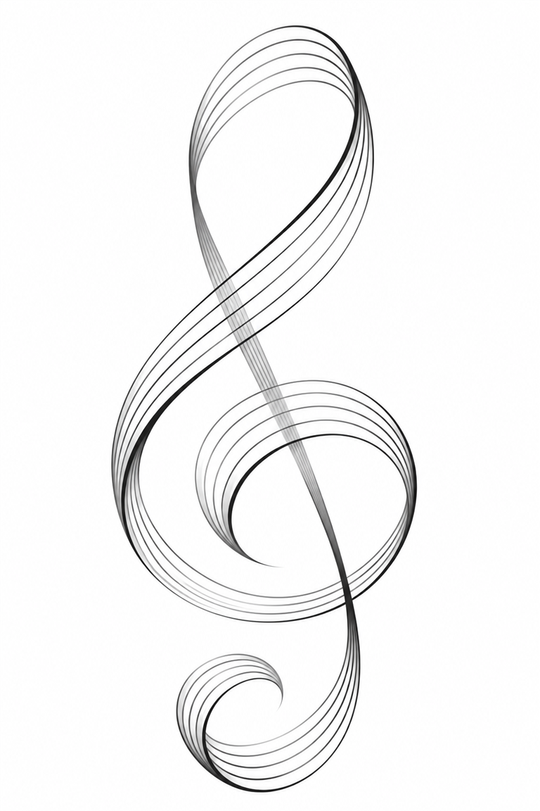

# Partune music

**Tuner, metronome, band rehearsal and sheet-music reader in one app.**
<br>
<sub>Built for the music stand, the rehearsal room and the stage.</sub>

<br>


<br>

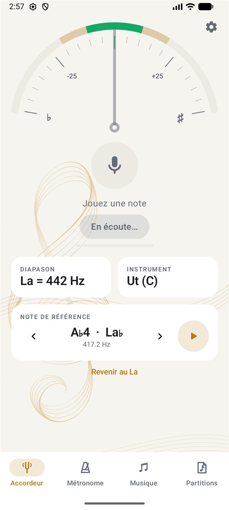&nbsp;
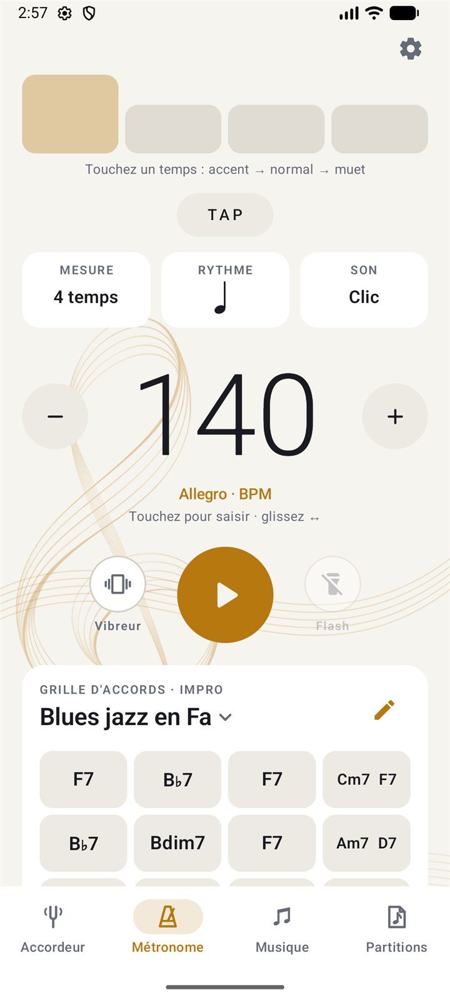&nbsp;
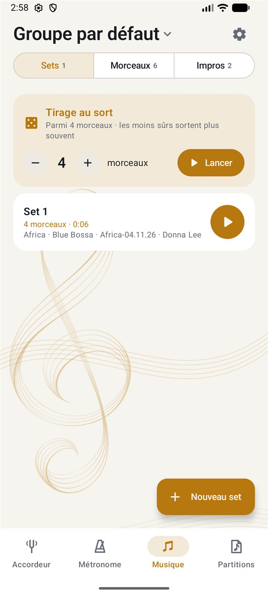&nbsp;
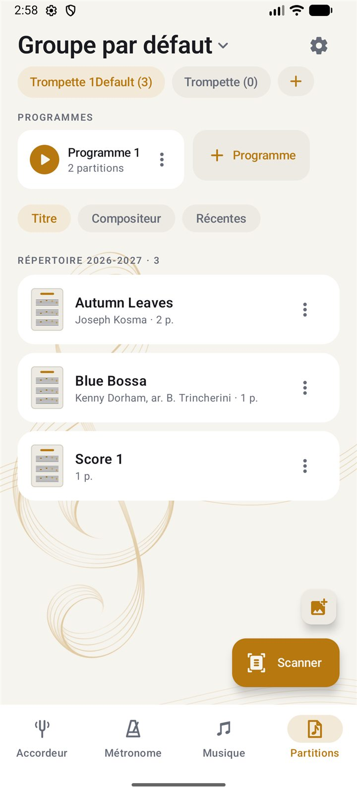&nbsp;
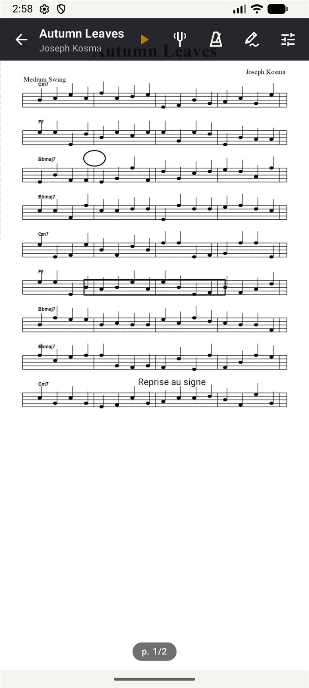

</div>

<br>

> *Part* for the score, *tune* for the right pitch: read it, play in time, sound in tune.
> Partune replaces the four apps that used to fill your case: the **tuner**, the **metronome**, the **band's songs** and your **scanned scores**. Four tabs, always within thumb's reach. The app remembers where you were, and each tool works with the others.

---

## 🎯 The tuner: the needle settles and the note is in tune

<table>
<tr>
<td width="34%" align="center"></td>
<td>

A stable, damped reading with a **±10 cent green zone**. The dial turns green when you are in tune.

- Concert pitch adjustable from **400 to 480 Hz** (440, 442…)
- Notes shown the way you read them: in **C, B♭, E♭ or F**, with sharps or flats
- A **reference note** to play, for tuning by ear
- Displayed precision: **±1 ¢**

</td>
</tr>
</table>

## 🥁 The metronome keeps time with you

<table>
<tr>
<td>

Generated **sample-accurate** in a single PCM stream, so there's no drift, even at **400 BPM** in sextuplets.

- Tap a beat to accent or mute it
- **10 rhythms** (eighths, triplets, shuffle, sextuplets…) · **4 sounds** (click, wood, hi-hat, beep)
- Swipe on the tempo, tap it in, or type it
- **Chord charts** that play along with the click, with a one-bar count-in
- **Vibration and flash**, so you can play loud without headphones

</td>
<td width="34%" align="center"></td>
</tr>
</table>

## 🎶 The band's repertoire, ready for rehearsal

<table>
<tr>
<td width="34%" align="center"></td>
<td width="34%" align="center">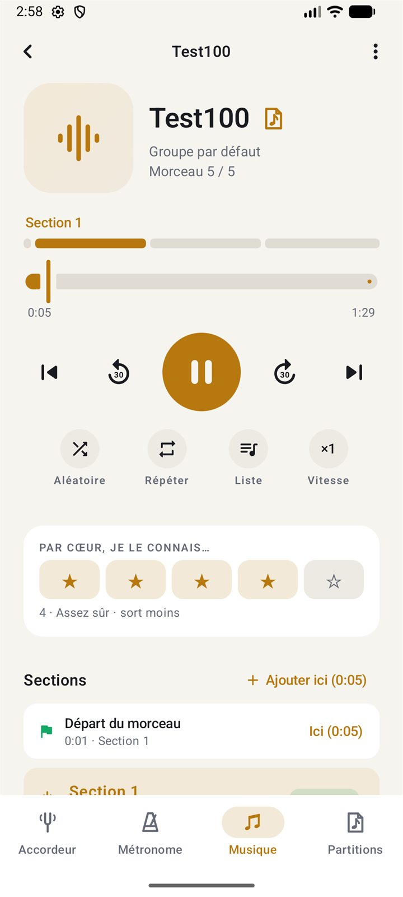</td>
<td width="32%" align="center">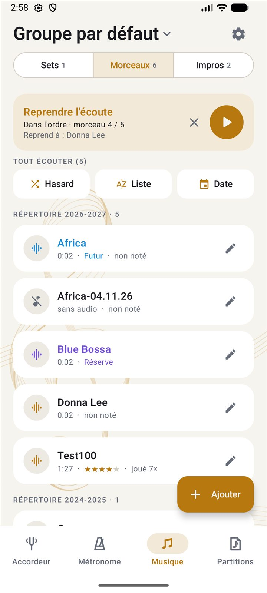</td>
</tr>
</table>

| | |
|---|---|
| ♪ **Announced sets** | Partune says each title aloud, counts *"one… two… one, two, three, four"*, then starts the song, with a pause between songs as on stage. |
| ⚄ **Shuffle to memorize** | Rate how well you know each song by heart: the shakiest ones come up more often. |
| ∞ **Looped sections** | Mark intro, theme and solo on the recording, loop the hard part, and slow it down to half speed. |
| ⤓ **One-tap import** | Audio files or a whole folder (phone, Google Drive), which can be re-synced later. Or record the rehearsal. |
| ❖ **Repertoires & seasons** | Sort by import year or by musical season, from September to August. |
| ⇄ **Shared sections** | Export every song's sections to Drive and re-import them on another phone. |

## 📜 Scores: scanned, split and titled

<table>
<tr>
<td>

Scan several pieces at once. Partune **straightens the pages**, **whitens the background**, finds where each piece starts and **reads its title**. You can sort by instrument and repertoire and build your **concert programmes**.

Then play from a reader made for the music stand:

- Tap right to go forward, left to go back, or use a **Bluetooth pedal**
- Full page, **half page**, continuous scroll or **two-page spread**
- Inverted colours for playing in the dark
- The linked song, the metronome and the tuner are each **one gesture away**

</td>
<td width="34%" align="center"></td>
</tr>
</table>

<div align="center">
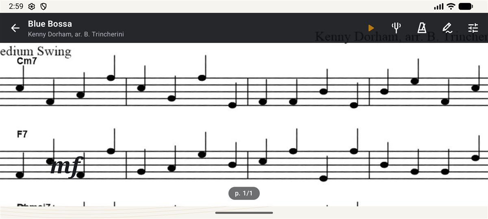
<br><sub><i>Landscape mode: full-width page, scroll down within it.</i></sub>
</div>

<br>

<table>
<tr>
<td width="25%" align="center">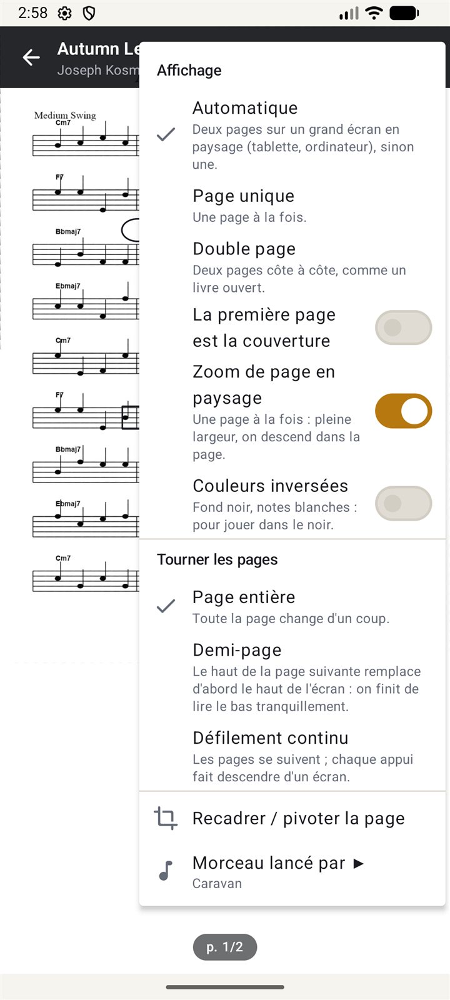<br><sub>Display & page turns</sub></td>
<td width="25%" align="center">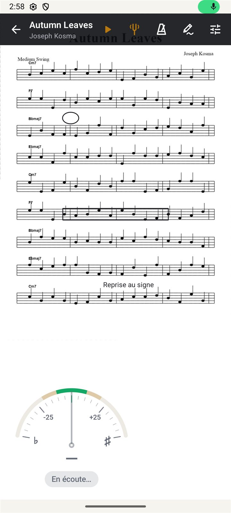<br><sub>Tuner over the score</sub></td>
<td width="25%" align="center">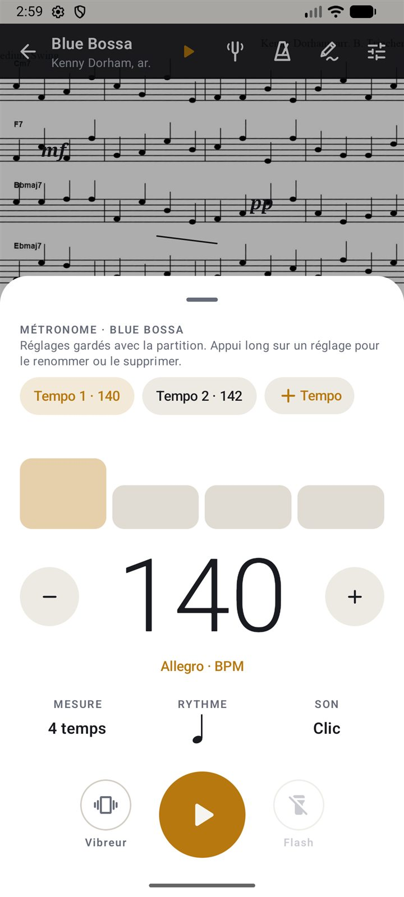<br><sub>The score's own metronome</sub></td>
<td width="25%" align="center">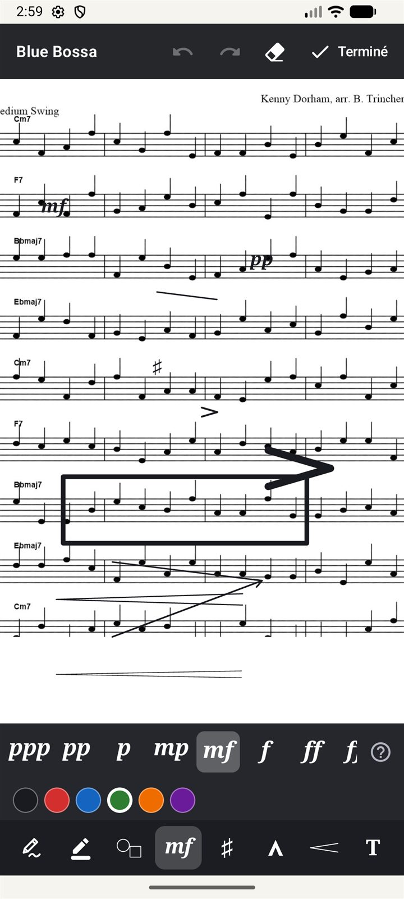<br><sub>Annotate like a pencil</sub></td>
</tr>
</table>

## ✏️ Annotate the way you would with a pencil

Pen, highlighter, shapes drawn with a swipe, arrows, free text and the whole score vocabulary:
`pp` `mp` `mf` `f` `ff` `sfz` `♯` `♭` `♮` `>` `^` `𝄐` `<` `○` `→`
Use two fingers to zoom and one to write. **The original image is never modified.**

---

<div align="center">

### 4 tools · 24 symbols & dynamics · 400 BPM without drift · 0 accounts to create

</div>

---

## 🔒 Your data stays on your phone

| Offline | On your device | Exportable |
|---|---|---|
| Everything works without a connection: at rehearsal, backstage, on tour. | Songs, scores and annotations stay on your device. No account, no server. | Scores as PDF (with annotations) and sections to Google Drive, when you choose. |

---

## 🍏 Help bring Partune to iPhone

Partune is Android-only for now. Releasing it on iOS needs a test iPhone, a Mac and an Apple Developer account. **Every tip in the app** (☕ coffee, 💻 laptop, 🖥️ Mac) goes to this fund.

<div align="center">


</div>

---

## 🛠️ Build

```bash
gradlew.bat assembleDebug
adb install -r app\build\outputs\apk\debug\app-debug.apk
```

Or open the folder in Android Studio and press ▶. For a release build, run `gradlew.bat assembleRelease`.

### Architecture

| Package | Role |
|---|---|
| `music/` | Pure music theory (notes, transpositions, chords, rhythms), ready for a future iOS port (Kotlin Multiplatform). |
| `audio/` | YIN pitch detection (tuner), a sample-accurate metronome mixed into a PCM stream, click/chord synthesis, and TTS count-in. |
| `data/` | Local JSON storage, with recordings in the app's private folder. |
| `player/` | Set sequencing (announce → count-in → play → next). |
| `billing/` | Google Play purchases (Partune Pro, tips) and the iOS fund counter. |
| `ui/` | Jetpack Compose screens. |

### Design

Dark for dim rooms, warm with the brass of the horns, and readable from 2 m away. See [DESIGN.md](DESIGN.md).


---

<div align="center">
<sub>Fewer apps. More music. · Made by <b>TrinchLab studio</b></sub>
</div>
